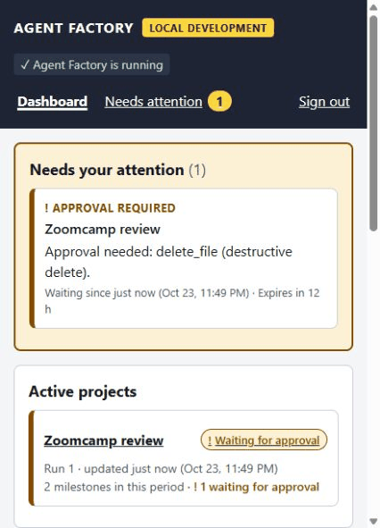

# Captured reviewer demo

These are real local browser captures of the public checkout, made October 24,
2026 UTC. Initial capture was before midnight October 23 in Denver; the post-patch
capture was after midnight. Application code matches
`e571dc3a8c965cdc4d24cb5d83bdc5bdf579ffd7`. After the original capture, Vite and
Undici received a [minimal security patch](../DEPENDENCY_PATCH.md). Screenshot 10
and the [patched runtime proof](patched-runtime.json) verify the patched app;
the original video and screenshots retain their original toolchain provenance. See [Day 3 validation](../DAY3_VALIDATION.md) and the
[submission package](../FINAL_SUBMISSION.md).

## Play the demonstration

[Open/download the GIF](approval-demo.gif) — 48 seconds, silent,
captured at 2 frames per second in the browser's responsive 426 × 591 viewport.
This is an edited sequence of actual screen-capture segments: pauses between
segments, launcher restart downtime and two transient viewport-resize frames are
omitted. No application screens
were fabricated or state changed for the images. Full-page screenshots below
preserve details beyond the narrow viewport. Credentials and sign-in are excluded.

| Clip time | What to notice |
| --- | --- |
| 0s | Dashboard: one exact action needs a human decision. |
| 3s | Project: deterministic fake provider; the run is paused for approval. |
| 6s | Exact action: delete the generated legacy_calc.py fixture. No attempt has occurred. |
| 9s | Action fingerprint and approval ID bind the decision to this exact request. |
| 11.5s | Confirmation: approval grants permission; it is not proof of execution. |
| 14.5s | Approve the exact generated fixture action, then wait for the worker. |
| 18.5s | The decision is recorded; execution is verified separately. |
| 22.5s | Execution succeeded in one recorded attempt. The timeline records dispatch, success, and resolution. |
| 27.5s | Run completed: implementation, five fixture tests, review, and the recorded human decision. |
| 31s | Progress remains in PostgreSQL; the browser is only a view. |
| 35s | After Ctrl+C and restart: the same project and completed run persist. |
| 39s | After restart: the same decision and successful execution remain, with one attempt. |
| 44s | Durable timeline: approved, dispatched, succeeded, resolved. One attempt after restart. |

The model is the deterministic **FakeProvider**. This demonstrates the local
approval and durable execution workflow, not real-model coding quality or a
public production deployment. The deletion targets only the generated
`legacy_calc.py` calculator fixture; a local recovery copy was preserved first.
The worker subsequently records **Succeeded**, **1 attempt**, and a completed run.

## Screenshots

| Evidence | Capture |
| --- | --- |
| Dashboard: one action needs attention | [Pending dashboard](01-dashboard-pending.jpg) |
| Project paused; fake model identified | [Pending project](02-project-pending.jpg) |
| Exact action, risk, expiry, fingerprint; nothing attempted | [Pending approval](03-approval-pending.jpg) |
| Separate confirmation of this action | [Confirmation](04-confirmation.jpg) |
| Recorded decision and successful execution timeline | [Action succeeded](05-action-succeeded.jpg) |
| Run completed; fixture tests and progress history | [Completed project](06-project-completed.jpg) |
| Same completed project after Ctrl+C and restart | [Project after restart](07-after-restart.jpg) |
| Same approval/execution, still exactly one attempt | [Execution after restart](08-execution-after-restart.jpg) |
| Compact final timeline | [Execution summary](09-execution-summary.jpg) |
| Same history on the patched Vite/Undici environment | [After security patch](10-after-security-patch.jpg) |

The [manifest](manifest.json) records capture timestamps, runtime source commit,
project/run/approval identity, clip chapters and SHA-256 hashes of every asset.
The full CI suite is separate evidence; the five tests displayed by the demo are
the generated calculator fixture's tests.
